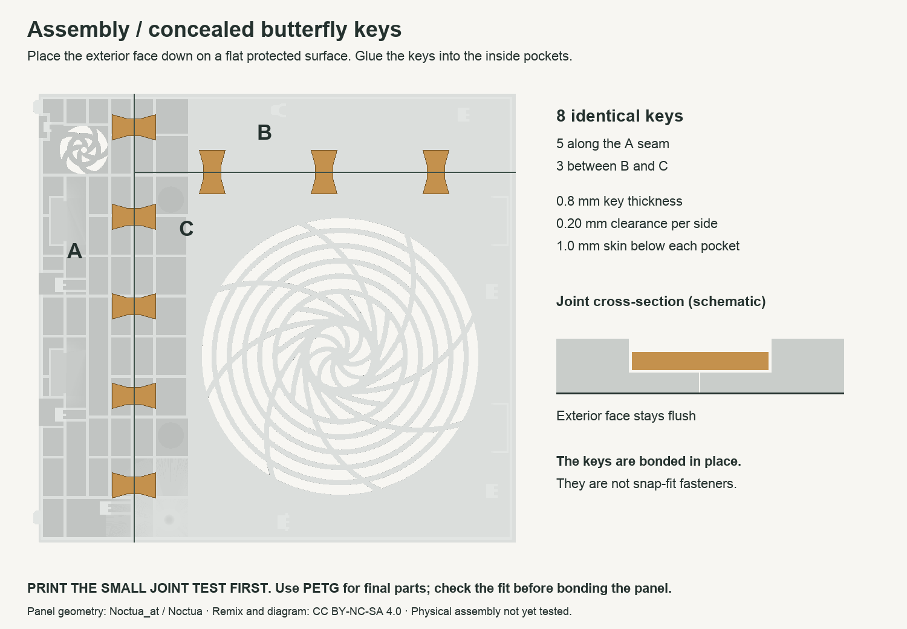
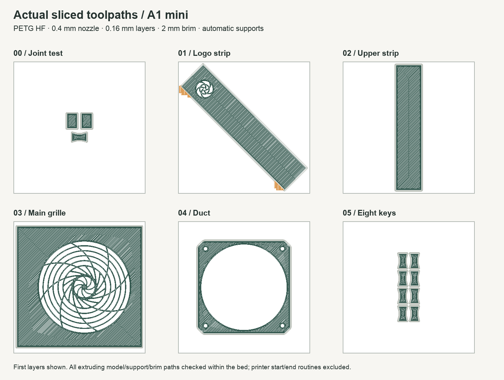

# Framework Desktop Noctua mod for the Bambu Lab A1 mini

## Glue-free alternative (V2)

A new **experimental glue-free revision** is available in [glue-free-v2](glue-free-v2/README.md). It uses sliding dovetail keys with release tongues. Print its two small PETG joint tests before the full panels. The V1 files below remain unchanged and still require glue. V2 adds up to 2 mm locally on the inside; case clearance and physical latch performance require testing.

[Download the glue-free V2 STL bundle](downloads/noctua-a1-mini-glue-free-v2-STLs.zip) · [V2 assembly instructions](glue-free-v2/README.md)

## Original glued version (V1)

Three-piece Noctua side panel with eight concealed glue-in butterfly keys, plus the original one-piece duct, prepared for the A1 mini's 180 × 180 mm bed. Designed for PETG and a 0.4 mm nozzle.

**Start with [the print and assembly guide](START_HERE.md) and the small joint test.** All six main files passed mesh and Bambu Studio slicing checks. Physical fit, joint strength, long-term heat resistance and acoustic/thermal performance have not been tested. The duct remains Noctua's original geometry; G2 seating must be checked on the hardware.

[Download the prepared STL bundle](downloads/noctua-a1-mini-STLs.zip)



## Contents

- `00_PRINT_FIRST_joint_test.stl`: two seam coupons and one standard key.
- `01_panel_A_logo_strip.stl`, `02_panel_B_upper_strip.stl`, `03_panel_C_main_grille.stl`: print one of each at 100% scale in the supplied orientation.
- `04_duct_whole.stl`: original duct, oriented flange-down.
- `05_keys_standard_PRINT_ONCE_8_keys.stl`: print this file once for eight keys.
- `optional_keys/`: single tighter/looser keys for tuning fit.
- `START_HERE.md`: settings, assembly steps and validation limits.
- `validation.json`, `slicing-validation.json`, `toolpath-validation.json`: recorded checks.
- `originals/`: the exact Noctua-named input files used, with hashes recorded in `validation.json`.
- `engineering/`: generator, dependency requirements and verified process overrides.
- `planning/`: original feasibility diagram, measurements and planning notes; final printing instructions take precedence.
- `downloads/`: separate V1 glued and V2 glue-free print bundles.



## Rebuild the meshes

With Python 3.12 available, run from the repository root:

```sh
python3 -m venv .venv
.venv/bin/python -m pip install -r engineering/requirements.txt
.venv/bin/python engineering/rebuild.py
```

The generator reads the bundled `originals/` and writes fresh STLs and geometry validation to `engineering/regenerated/`. It also writes a reference assembly under `engineering/work/`. It does not rerun Bambu Studio or regenerate the assembly/toolpath images. Re-run slicer verification if geometry or settings change. Dependency versions or platforms may change triangulation and file hashes.

## Attribution and license

Original panel and duct by **Noctua_at / Noctua**. This independent remix adds the three-piece split, recessed key pockets, butterfly keys, test pieces and print orientations. The original grille and duct flow geometry are retained.

- [Original panel](https://www.printables.com/model/1368247-framework-destktop-side-panel-with-noctua-style-fa/files)
- [Original duct](https://www.printables.com/model/1368249-framework-desktop-custom-fan-duct)
- [Noctua's testing and article](https://www.noctua.at/en/expertise/blog/how-to-make-the-framework-desktop-run-even-quieter)

The models and derived diagrams are distributed under **CC BY-NC-SA 4.0**. See [LICENSE.md](LICENSE.md). This project is not endorsed by Noctua or Framework.
