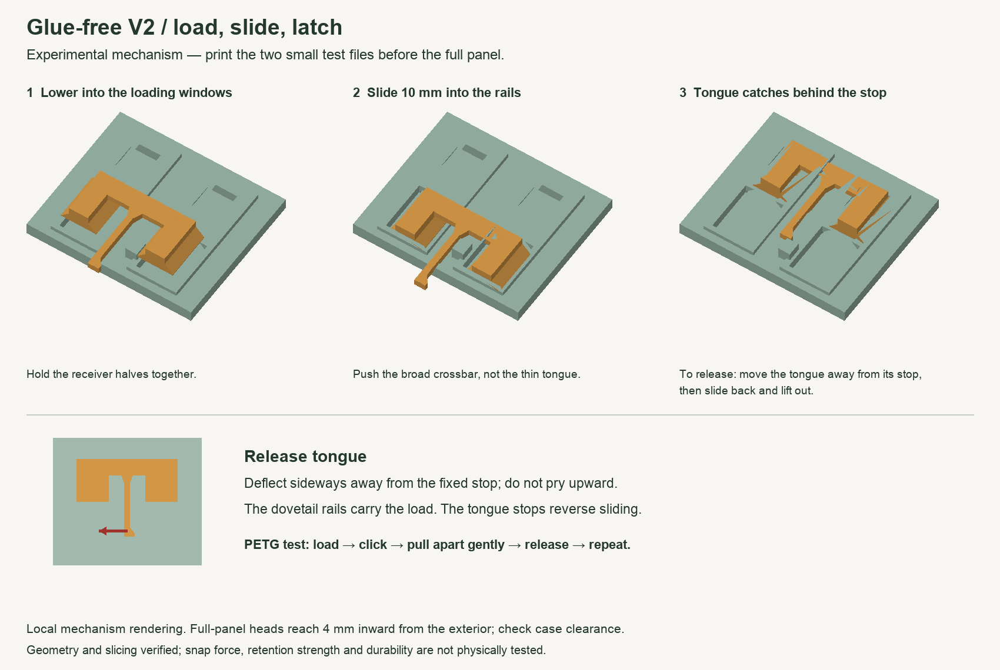
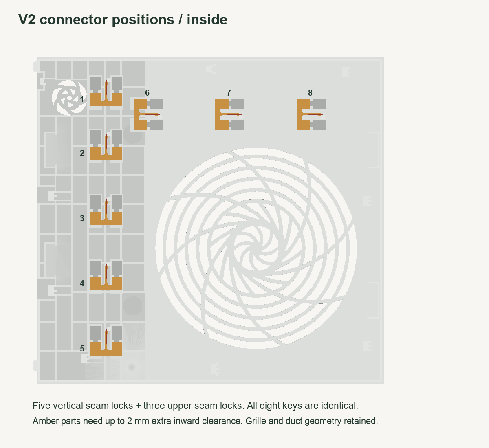

# Glue-free V2 — experimental sliding locks

**Print the two small PETG test files first.** This revision has passed geometry and A1 mini slicing checks, but the latch has not been physically printed or tested. Do not print a whole replacement panel until the test joint locks and releases reliably and the extra inward clearance has been checked.

This is a different connection system from V1. **V1 panels and butterfly keys are not compatible with V2.** V1 remains at the repository root and still requires glue.

## Print first

1. `00a_PRINT_FIRST_receiver_halves.stl` — one copy. This contains two separate receiver halves cut from the actual revised panel joint.
2. `00b_PRINT_FIRST_sliding_key.stl` — one copy. This is the standard key used in the full panel.

Together: approximately **2.0 g PETG and 24 minutes** across two jobs with the verified profile. You can put both files on one plate if you preserve each file's supplied orientation and keep the pieces separate.

Use **A1 mini / 0.4 mm nozzle / 0.16 mm Optimal** with a filament profile matching your PETG (the slicing checks used Bambu PETG HF), 0.20 mm first layer, 4 walls, 5 top and bottom layers, 20% gyroid infill, and 0.15 mm elephant-foot compensation. Use a 2 mm outside brim with 0.15 mm object gap if necessary. **Supports OFF for the test halves and all keys.** Outer wall speed 45 mm/s; initial layer speed 20 mm/s. Use the filament manufacturer's drying and temperature guidance for your actual PETG.

**Keep the supplied orientations and 100% scale.** The key is deliberately exported upside-down: its crossbar and flexible tongue print against the bed, with the dovetail feet growing upward. Do not auto-orient it. The receiver prints exterior-face-down with its tracks facing upward.

## How it locks



1. Let the prints cool. Remove brim and any first-layer flare without nicking the tongue or rail edges. Clear any stringing from the tracks.
2. Put the two receiver halves exterior-face-down on a flat surface, with their straight seam edges touching. Their tracks should run in the same direction.
3. Flip the printed key to its installed orientation: **dovetail feet down, broad crossbar and tongue up**. Put its two feet into the two wide loading windows. The tongue extends toward the loading end, opposite the direction of sliding.
4. Push the **broad crossbar** about **10 mm toward the narrow track ends**. Do not push on the slender tongue. The feet slide under the dovetail rails and the tongue's side hook should pass the fixed stop and catch behind it.
5. Gently check that the halves resist pulling apart and that the key cannot lift out or slide backward freely.
6. To release, move the free end of the tongue **sideways away from the fixed stop**, then slide the key backward into the loading windows and lift it out. Do not pry the tongue upward.

The dovetail rails retain the halves. The tongue only prevents reverse sliding. The latch is nominally relaxed after engagement; it does not depend on continuous friction to hold the key in place.

## What to report from the test

- Whether the feet drop into the loading windows and slide without forcing.
- Whether the tongue catches behind the stop, then releases deliberately.
- Whether the two faces stay level and the joint holds during gentle handling.
- Whether the tongue or rail tips whiten, crack, jam or develop excessive play after several assembly/release cycles.

**Stop if the key needs substantial force.** `optional_key_loose.stl` and `optional_key_snug.stl` change the clearance of the dovetail feet/stems only (0.30 / 0.10 mm per side, versus 0.20 mm standard). They do not change the latch hook or spring stiffness. If the sliding fit is good but the latch does not catch or release, the latch geometry needs adjustment; changing the key's overall scale is not the fix.

PLA can demonstrate the assembly sequence, but test the latch in the PETG intended for the final parts before using that result to approve the design. Do not assume a successful PLA test establishes PETG clearances or durability.

## Full-panel files — after the test passes

- `01_panel_A_glue_free.stl`: print one; already diagonal for the A1 mini.
- `02_panel_B_glue_free.stl`: print one.
- `03_panel_C_glue_free.stl`: print one; the complete Noctua grille remains in this part.
- `04_sliding_keys_PRINT_ONCE_8_keys.stl`: print the file once for all eight standard keys. Alternatively print eight of the selected single key after testing its fit.
- Reuse the original `04_duct_whole.stl` from V1 at the repository root. **The duct does not change for V2.** It is also supplied as `05_duct_unchanged.stl` in the downloadable bundle.

For full panels, use the settings above but **enable normal automatic supports**, 30° threshold, build-plate-only OFF, top Z distance 0.20 mm, support/object XY distance 0.35 mm. Those supports address original case mounting details. Inspect the tracks in the preview and remove any generated supports/stringing before assembly. Key and receiver test prints need no supports in their supplied orientations.

The key heads/catches reach **4.0 mm inward from the exterior panel face**. The original skin is approximately 2.0–2.8 mm thick, so V2 adds **up to 2.0 mm locally**. This is not a flush-with-the-original-inner-surface design like the glued V1 keys. The extra thickness is confined to solid-border connector locations, but clearance to actual case internals has **not** been verified. Check every amber location on the map before committing to full prints. Existing protruding case mounts are retained.



Assemble the panel outside the computer, align all three exterior faces on a flat surface and install the eight keys. The vertical seam connectors slide downward in the map; the three upper-seam connectors slide left. Make sure all keys latch. Check that the assembly stays together when gently lifted, fits the case without pressure, and does not rattle. Do not install a loose key. Check G2/duct clearance with the computer powered off before use. The G2 and 80 mm fan choices do not otherwise change this connection geometry.

## Evidence and limits

- Every exported STL is watertight, consistently wound and has its expected number of solids.
- CAD volume checks preserve the original exterior layer and complete main grille region, and retain the original case mounting protrusions.
- The source-to-print transform preserves handedness; the panel is not mirrored.
- All eight installed keys are collision-free against the panel and each other.
- Sampled rigid slide and vertical insertion paths are clear.
- Geometric checks show that the rails block upward removal and pulling the receiver halves apart, and the latch blocks backward movement.
- A modeled sideways tongue deflection of 0.7 mm clears the release path. **This is a geometric motion check, not finite-element analysis or proof that PETG can withstand the required force.**
- A maximum 0.001 mm export simplification removes numerical slivers from the STL; the original flow geometry is not intentionally redesigned.
- Bambu Studio 2.7.1.62 sliced all eight new files successfully with the A1 mini settings. Model/support/brim extrusion paths, including arcs, fit within the 180 × 180 mm bed. The unchanged duct retains its separately checked V1 geometry/slice evidence.

Physical snap force, retention strength, fatigue, creep, case clearance, rattle and thermal/acoustic performance remain unverified. Full-panel files are provided for the next stage after a successful test, not as a claim of a validated production latch.

## Rebuild

From the repository root, install the pinned geometry dependencies in an isolated Python 3.12 environment, then run:

```sh
python3 -m venv .venv
.venv/bin/python -m pip install -r glue-free-v2/engineering/requirements.txt
.venv/bin/python glue-free-v2/engineering/build.py
```

The generator reads the original source STL in `originals/` and writes V2 meshes/geometry validation into this folder. It does not automatically slice, create the documentation images, or refresh the download ZIP. The optional `--reference-dir /path/to/scratch` writes reference geometry for inspection. Rebuilding may change triangulation across package/platform versions.

## Attribution

Original panel and duct by **Noctua_at / Noctua**. V2 adds the three-way split, recessed dovetail tracks, top-loading windows, separate sliding keys and release tongues. This independent experimental remix is not endorsed by Noctua or Framework. Original sources and attribution are listed in the repository root README.

Models, generator and derived diagrams: **CC BY-NC-SA 4.0** — https://creativecommons.org/licenses/by-nc-sa/4.0/
