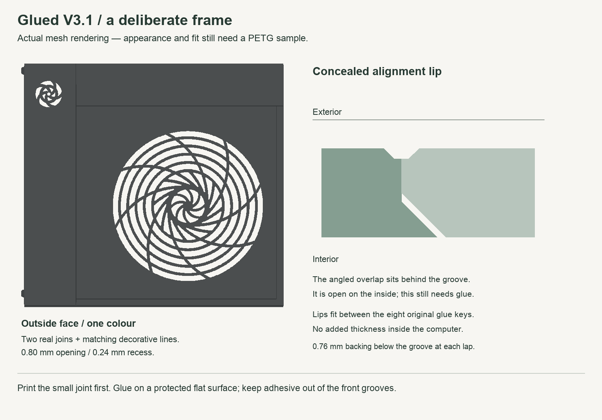
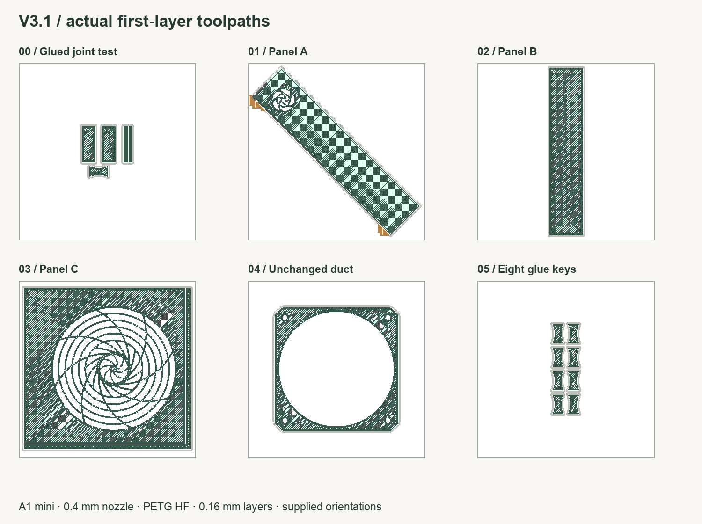

# Glued framed V3.1 — print the small sample first

V3.1 returns to the concealed glue-in butterfly keys and gives the seams a deliberate appearance. The two real joins sit inside shallow decorative channels; matching right and bottom channels frame the main grille. Eight short angled overlap lips help position the pieces during gluing. The lips do not latch or hold the assembly without glue.

**This is a print-ready prototype, not a physically validated panel.** Mesh and A1 mini slicing checks passed. Print and glue the small PETG sample before committing to the full panel. The design makes joins look intentional; it does not make them invisible.

## Revision notice

**Use V3.1 instead of the initial V3 download.** Review found that the old lap recess left only 0.16 mm of backing beneath the groove. V3.1 preserves 0.76 mm there and uses shorter alignment lips. Replace all three original V3 panel pieces together; their revised joints must not be mixed. The key and duct are unchanged. `validation.json` must show revision `3.1`.

## Print first

Print **`00_PRINT_FIRST_framed_glued_joint.stl` once**. It contains **four separate pieces**: two panel samples, one glue key and a narrow unbroken groove strip. The seam samples use the actual revised lip and key pocket; the narrow strip is cut from the decorative right border for comparing the finish. Estimated print: **22 minutes / 3.79 g PETG** with the checked profile, including printer preparation.

- Bambu A1 mini, 0.4 mm nozzle, **0.16 mm layers**, 0.20 mm first layer.
- Use a filament profile matching your PETG. Verification used Bambu PETG HF; it is not a requirement to buy HF.
- **100% scale, supplied orientation, exterior face against the bed.** Do not auto-orient.
- Supports **OFF** for the test and glue keys.
- Four walls, five top/bottom layers, 20% gyroid infill.
- Outer walls 45 mm/s, initial layer 20 mm/s; 0.15 mm elephant-foot compensation.
- Checked with a 2 mm outside brim and 0.15 mm brim gap. Carefully remove it without rounding the mating edges.

Keep the same build-plate surface and filament for all panel pieces to make the finish consistent. Lower layer heights alone will not remove an assembly seam. First-layer compensation and extrusion can change the apparent groove width: the printed result must be assessed on the sample.

### Assemble the sample

1. Set the narrow unbroken groove strip aside: it is a comparison sample, not an assembly part. Let the prints cool, remove the brim/stringing and dry-fit the pieces. Keep their exterior faces down on a clean, flat, protected surface. The angled lip belongs inside its matching recess. Do not force or sand away the lip to make it fit.
2. Bring the straight edges together and check that both exterior faces lie flat. The lip is deliberately loose enough for assembly; the flat surface establishes the final alignment.
3. Dry-fit the butterfly key in the inside pocket. It should sit below the surrounding inside surface. It is a glue-in key, not a snap fit.
4. Use an adhesive suitable for your actual PETG, following its instructions. Apply sparingly at the internal lap and key bonding surfaces; keep adhesive out of the visible groove and off the exterior. Protect the assembly surface from accidental bonding.
5. Keep the faces flat and the joint closed while the adhesive cures for its specified time. Do not rely on the printed lips to clamp the pieces.
6. Place the unbroken groove strip beside the cured seam under the lighting where the computer will sit. Compare groove width and finish; check that neither seam face stands proud and the cured joint holds during gentle handling. A mismatch is feedback for adjusting the sample, not a reason to print the whole panel.

If the faces cannot lie flat before gluing, or the groove looks too broad/rough, adjust the sample before printing the full panel. Do not globally scale the models to tune a joint: that changes the case fit.

## Full panel, after the sample passes

Print one each of `01_panel_A_logo_strip.stl`, `02_panel_B_upper_strip.stl`, and `03_panel_C_main_grille.stl`. A is already diagonal for the A1 mini. Print `05_keys_standard_PRINT_ONCE_8_keys.stl` once for eight keys. The original duct is supplied as `04_duct_unchanged.stl`; reuse your existing duct if already printed.

Enable **normal automatic supports** on the full panel pieces and duct using the checked settings: 30° threshold, build-plate-only OFF, support top Z distance 0.20 mm, support/object XY distance 0.35 mm. These address the original mounting features. Inspect the preview and clear supports from the internal details before assembly. The test and keys remain support-free.

Dry-fit all three pieces before applying adhesive. With exterior faces down, A's lips overlap into B/C, and B's lips overlap into C. Set A, bring B into place, then slide C diagonally into both edges. Keep the faces flat and close the joins; do not bend the panel around a jammed lip. Glue the eight recessed keys and internal laps sparingly, leaving the front grooves clear. Cure on the protected flat surface. Check the complete panel's case fit and fan/duct clearance before use.

**Do not mix V3.1 panel pieces with initial V3, V1 or V2.** The V1 butterfly-key geometry and unchanged duct are reusable; V2 sliding locks are not used. V1 and V2 remain available in the repository.

## Dimensions and checked limits

- Decorative groove: **0.80 mm wide at the face, 0.32 mm at the floor, 0.24 mm deep**.
- Backing beneath the groove at both the key pockets and lap recesses: **0.76 mm nominal**, versus initial V3's 0.16 mm at the lap recesses and V1's 1.0 mm beneath its key pockets. This is a local strength tradeoff requiring the glued sample test.
- Eight lips: 0.8 mm overlap, nominal 0.20 mm vertical relief and 1.00 mm end relief (for two-edge insertion). The angled undersides grow at 45° in the supplied print orientation.
- **No additional internal thickness**: the assembled CAD remains inside the original panel envelope.
- Main grille region and original mounting protrusions retained; duct copied byte-for-byte from V1. The original skin from 0.24 to 1.00 mm depth behind the decorative grooves remains, so the grooves are recesses rather than new through-slots.
- All new meshes are watertight with the intended separate solids. Installed keys and panel parts do not intersect. Sampled assembly paths for B and C are clear. STL export uses up to 0.001 mm simplification to remove numerical slivers.
- All six files sliced successfully in Bambu Studio 2.7.1.62 for the A1 mini. Checked extrusion paths, including brim, supports and arcs, fit the bed. Geometry, slicing and toolpath receipts are linked by STL/G-code hashes. The packaging script rejects missing or mismatched receipts.

Physical finish, bonding strength, case fit and thermal/acoustic performance are not verified. Preserving the airflow geometry is not a measured cooling result.

## Rebuild

From the repository root, install `glued-framed-v3/engineering/requirements.txt` in an isolated Python environment, then run `python glued-framed-v3/engineering/build.py`. Original Noctua meshes are read from `originals/`. Optional `--reference-dir /path/to/scratch` exports inspection geometry. The build does not refresh the images, slicing receipts or ZIP; rerun those checks after geometry changes. The slicer script in `engineering/verify_slicing.py` uses an installed macOS Bambu Studio and accepts `--scratch-dir` for its intermediate files. Run `engineering/render_and_check.py --reference-dir /path/to/references --slicer-dir /path/to/slicer-scratch` to refresh the illustrations and extrusion-bound checks (macOS fonts; requires Pillow).

Run `engineering/check_backing_regression.py` to confirm the stronger backing check rejects the original thin V3 recess. The build also checks the exported panel meshes after reversing their print transforms. Run `python glued-framed-v3/engineering/package.py` only after build, slice and render checks; it verifies the receipts and produces the current download ZIP.

Original sources: [Noctua panel](https://www.printables.com/model/1368247-framework-destktop-side-panel-with-noctua-style-fa), [Noctua duct](https://www.printables.com/model/1368249-framework-desktop-custom-fan-duct), and [Noctua article](https://www.noctua.at/en/expertise/blog/how-to-make-the-framework-desktop-run-even-quieter).

Original panel/duct by **Noctua_at / Noctua**. Independent remix, not endorsed by Noctua or Framework. Original sources and license are in the repository root. Models, generator and derived diagrams: **CC BY-NC-SA 4.0**.
